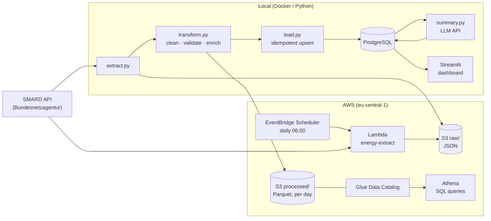

# German Energy Market Data Pipeline

An automated ETL pipeline for hourly German electricity data. It collects
day-ahead prices, solar and wind generation, and total consumption from the
**SMARD API** (Bundesnetzagentur), cleans and validates them, stores them in
**PostgreSQL** and an **AWS S3 data lake** (queryable with **Glue + Athena**),
runs daily on **AWS Lambda**, and shows the results in a **Streamlit dashboard**
with an **LLM-generated daily market summary**.

**Key question:** How do solar and wind generation affect electricity prices?

## Results

Based on 8 weeks of hourly data (14 Sep – 2 Nov 2026, 1,193 hours):

| Solar + wind generation | Average day-ahead price |
|---|---|
| Lowest 20 % of hours (< 10,000 MWh) | **241 €/MWh** |
| Highest 20 % of hours (> 42,000 MWh) | **58 €/MWh** |

- Correlation between price and solar + wind generation: **−0.77** (strong negative).
- Prices are lowest at **13:00** (solar peak, 92 €/MWh average) and highest at
  **19:00** (no sun, high demand, 259 €/MWh).
- On sunny, windy weekends prices turned **negative** (down to −2.49 €/MWh).
- Solar + wind covered **49 %** of German electricity consumption on average,
  ranging from 1 % to 118 % of consumption in a single hour (surplus is exported).

## Architecture



| Step | What happens | Code |
|---|---|---|
| Extract | Downloads the last N weekly chunks of 5 series. Timeouts, retries with backoff, polite delay. Raw responses are saved unchanged. | [src/extract.py](src/extract.py) |
| Transform | Merges series, removes duplicate hours, drops incomplete hours, validates (price range, no negative generation, no missing hours), adds renewable share and German local time. | [src/transform.py](src/transform.py) |
| Load | Upserts into PostgreSQL (`INSERT … ON CONFLICT DO UPDATE`), so reruns never create duplicates and corrected values replace old ones. | [src/load.py](src/load.py) |
| S3 / Athena | Raw JSON and daily Parquet partitions in S3; Athena table with partition projection (no crawler). | [src/s3_upload.py](src/s3_upload.py), [sql/athena/](sql/athena/) |
| Lambda | Daily extraction in the cloud, scheduled by EventBridge, least-privilege IAM. | [aws/](aws/) |
| Summary | Python computes the day's numbers; an LLM turns them into 3–4 factual sentences. | [src/summary.py](src/summary.py) |
| Dashboard | Date filter, KPIs, price vs. generation, price by hour, scatter plot, LLM summary. | [dashboard/app.py](dashboard/app.py) |
| Runner | Runs all steps, logs each step, exits with code 1 on failure. | [src/pipeline.py](src/pipeline.py) |

## Screenshots

_Screenshots coming soon._

<!-- Add images to docs/screenshots/ and reference them here, e.g.:


-->

## Tech stack

| Area | Tools |
|---|---|
| Data processing | Python 3.14, pandas, PyArrow / Parquet |
| Database | PostgreSQL 17 (Docker Compose), SQL (window functions, upserts) |
| Cloud | AWS S3, Glue Data Catalog, Athena, Lambda, EventBridge Scheduler, IAM, CloudWatch |
| Web app | Streamlit, Altair |
| LLM | Anthropic Python SDK |
| Quality | pytest (29 tests), moto (simulated AWS), logging |

## Getting started

**Prerequisites:** Python 3.14, Docker Desktop, git.

```zsh
git clone <this repository>
cd energy-data-pipeline
python3 -m venv .venv
source .venv/bin/activate
pip install -r requirements-dev.txt

cp .env.example .env              # then set your own POSTGRES_PASSWORD
docker compose up -d              # starts PostgreSQL on localhost:5433
```

**Run the pipeline** (downloads 8 weeks, about 25 seconds):

```zsh
python src/pipeline.py
python src/pipeline.py --weeks 2  # less history
```

**Open the dashboard:**

```zsh
streamlit run dashboard/app.py    # http://localhost:8501
```

**Run the tests** (no internet, database or AWS account needed):

```zsh
pytest
```

**Analysis queries in PostgreSQL:**

```zsh
docker compose exec -T postgres psql -U energy -d energy < sql/analysis.sql
```

### Optional features

| Feature | Setting in `.env` | Guide |
|---|---|---|
| Upload to S3, query with Athena, daily Lambda | `S3_BUCKET`, `AWS_PROFILE` | [docs/AWS_SETUP.md](docs/AWS_SETUP.md) |
| Daily LLM summary in the dashboard | `ANTHROPIC_API_KEY` | `python src/summary.py` |

Without these settings, the pipeline skips the steps and everything else works locally.

## Project structure

```
energy-data-pipeline/
├── src/
│   ├── extract.py          # SMARD API -> data/raw/<date>/<series>/<chunk>.json
│   ├── transform.py        # clean, validate, enrich -> data/processed/*.parquet
│   ├── load.py             # idempotent upsert into PostgreSQL
│   ├── s3_upload.py        # raw + processed data to the S3 data lake
│   ├── summary.py          # daily market summary with an LLM
│   ├── pipeline.py         # runs all steps
│   └── logging_setup.py
├── dashboard/app.py        # Streamlit dashboard
├── aws/
│   ├── lambda_function.py  # Lambda entry point (daily extraction)
│   ├── build_lambda.sh     # builds dist/lambda.zip
│   └── iam/                # least-privilege IAM policies
├── sql/
│   ├── schema.sql          # PostgreSQL tables
│   ├── analysis.sql        # analysis queries
│   └── athena/             # Glue/Athena table and example queries
├── tests/                  # pytest
├── docs/AWS_SETUP.md       # step-by-step AWS guide, costs, cleanup
└── docker-compose.yml
```

## Design decisions

- **Keep raw data unchanged.** Every API response is stored as-is. If the
  transform has a bug, it can be fixed and rerun without calling the API again.
- **Store UTC, analyse in German time.** Timestamps are stored in UTC, which has
  no daylight-saving jumps. Hour and weekday are derived in `Europe/Berlin`. On
  25 Oct 2026, 02:00 local time occurs twice; the tests cover this case.
- **Fail loudly on bad data.** Validation raises an error instead of loading
  questionable data. The database repeats key checks as `CHECK` constraints.
- **Idempotent loads.** A primary key on the timestamp plus `ON CONFLICT DO UPDATE`
  makes reruns safe. This matters in practice: SMARD revises recent values, and
  the upsert replaces them without duplicates.
- **Weighted renewable share.** Total solar + wind energy divided by total
  consumption, not an average of hourly percentages.
- **Partition projection instead of a Glue crawler.** It's free, needs no
  scheduled runs, and new days are queryable immediately.
- **LLM only for wording.** All numbers are computed in Python and passed to the
  model, which is told to use only those numbers. Summaries are stored once per
  day instead of generated on every page view.

## Costs

The AWS part is designed to stay near €0 per month (a few MB in S3, one short
Lambda run per day, Athena queries over a few hundred KB). There's no Glue
crawler, there's a 1 GB per-query limit in Athena, and logs have 14-day
retention. A daily LLM summary costs about one US cent. Details are in
[docs/AWS_SETUP.md](docs/AWS_SETUP.md#costs-read-this-first).

## What I learned

- How a real API delivers data: weekly chunks, values published at different
  times (prices a day ahead, generation afterwards), and values that are revised.
- Why idempotency matters: reruns and corrections must not create duplicates.
- Time zones and daylight saving: a day can have 23 or 25 hours, and a chart
  using local time drew a false spike until I switched to UTC.
- Data quality checks in two layers: validation in Python and constraints in SQL.
- Cloud cost awareness: partition projection instead of a crawler, a scan limit
  in Athena, log retention and a budget alert.
- Least-privilege IAM: separate roles for Lambda, the scheduler and the pipeline user.
- Using an LLM responsibly in a data product: grounding the model in computed numbers.

## Data source

Data: [SMARD.de](https://www.smard.de), Bundesnetzagentur | SMARD.de, licensed
under [CC BY 4.0](https://creativecommons.org/licenses/by/4.0/).
